# ServiceNow Extension - Architecture Documentation

## Table of Contents
1. [Overview](#overview)
2. [Five-Layer Architecture](#five-layer-architecture)
3. [Component Diagrams](#component-diagrams)
4. [Authentication Architecture](#authentication-architecture)
5. [Request Flow](#request-flow)
6. [Entity Operations](#entity-operations)
7. [Error Handling](#error-handling)
8. [Performance Considerations](#performance-considerations)
9. [Deployment Architecture](#deployment-architecture)

---

## Overview

The ServiceNow Extension follows a **five-layer architecture** pattern that provides clear separation of concerns, maintainability, and scalability. The extension integrates with ServiceNow's REST APIs to perform IT Service Management (ITSM) operations.

### Key Characteristics
- **Version**: 2.0.6
- **JAXRS ID**: servicenow
- **Architecture Pattern**: Layered Architecture with Dependency Injection
- **Authentication**: OAuth 2.0 and Basic Authentication
- **API Version**: ServiceNow REST API v1
- **Java Version**: 11
- **Framework**: Krista Service APIs 1.0.101

---

## Five-Layer Architecture

The extension is organized into five distinct layers, each with specific responsibilities:

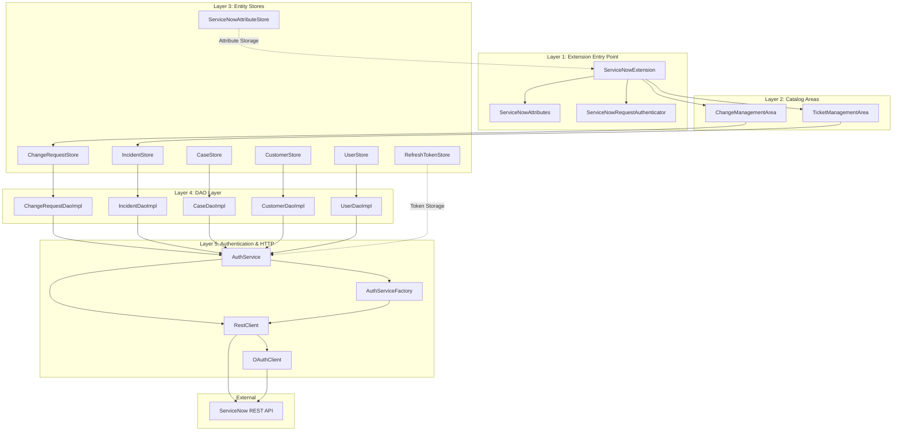

### Layer 1: Extension Entry Point

**Purpose**: Extension initialization, configuration management, and lifecycle handling

**Components**:
- **ServiceNowExtension**: Main extension class annotated with `@Extension`
  - Handles extension lifecycle events
  - Provides RequestAuthenticator
  - Validates connection and attributes
  - Manages custom tabs
  
- **ServiceNowAttributes**: Configuration holder
  - Stores authentication credentials
  - Manages instance URL
  - Provides callback URI generation
  
- **ServiceNowRequestAuthenticator**: Authorization handler
  - Implements RequestAuthenticator interface
  - Handles OAuth authorization flow
  - Generates authorization URLs

**Lifecycle Methods**:
- `testConnection()`: Validates connection to ServiceNow
- `validateAttributes()`: Validates configuration attributes
- `attributesUpdated()`: Handles attribute updates
- `customTabs()`: Provides custom documentation tab
- `getRequestAuthenticator()`: Returns authenticator instance

### Layer 2: Catalog Areas

**Purpose**: Business logic for catalog requests

**Components**:
- **ChangeManagementArea**: Change request operations
  - Escalate Issue
  - Check Status
  - Approve Change Request
  
- **TicketManagementArea**: Incident operations
  - Assign User to Incident

**Responsibilities**:
- Input validation and transformation
- Orchestrating entity store operations
- Business rule enforcement
- Logging and error handling

### Layer 3: Entity Stores

**Purpose**: CRUD operations and search functionality for entities

**Components**:
- **ChangeRequestStore**: Change Request entity operations
- **IncidentStore**: Incident entity operations
- **CaseStore**: Case entity operations
- **CustomerStore**: Customer entity operations
- **UserStore**: User entity operations
- **RefreshTokenStore**: OAuth token persistence
- **ServiceNowAttributeStore**: Attribute persistence for OAuth contexts

**Operations**:
- `create(Map<String, Object>)`: Create new entity
- `get(String primaryKey)`: Retrieve entity by ID
- `update(Entity)`: Update existing entity
- `delete(String primaryKey)`: Delete entity
- `search(SearchQuery, pageIndex, pageSize)`: Search entities
- `count(List<SearchCondition>)`: Count entities
- `contains(String primaryKey)`: Check entity existence

### Layer 4: DAO Layer

**Purpose**: Direct interaction with ServiceNow REST APIs

**Components**:
- **ChangeRequestDaoImpl**: Change request API operations
- **IncidentDaoImpl**: Incident API operations
- **CaseDaoImpl**: Case API operations
- **CustomerDaoImpl**: Customer API operations
- **UserDaoImpl**: User API operations

**Responsibilities**:
- HTTP request construction
- JSON payload preparation
- Response parsing
- Error handling and transformation
- Query parameter building

### Layer 5: Authentication & HTTP

**Purpose**: Authentication management and HTTP communication

**Components**:
- **AuthService**: Authentication orchestration
  - Determines auth type (OAuth/BasicAuth)
  - Retrieves and validates tokens
  - Provides RestClient instances
  
- **AuthServiceFactory**: AuthService instance creation
  - Creates AuthService with appropriate configuration
  - Manages default and custom instances
  
- **RestClient**: HTTP client wrapper
  - Supports GET, POST, PUT, PATCH, DELETE
  - Adds authentication headers
  - Handles HTTP responses
  
- **OAuthClient**: OAuth 2.0 flow implementation
  - Generates authorization URLs
  - Exchanges authorization codes for tokens
  - Handles token refresh

---

## Component Diagrams

### Dependency Injection Flow

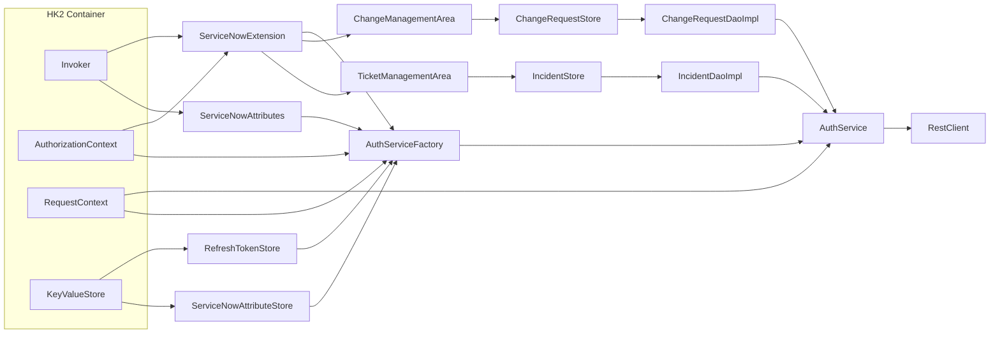

### Extension Initialization Sequence

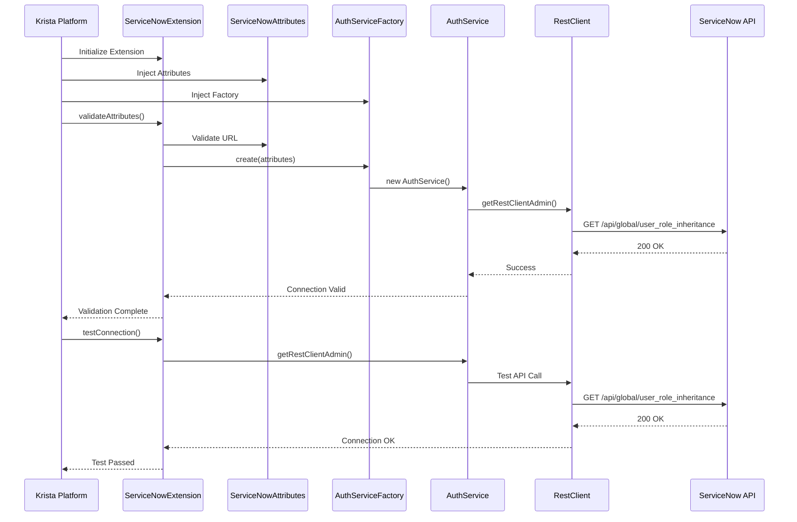

---

## Authentication Architecture

### OAuth 2.0 Flow

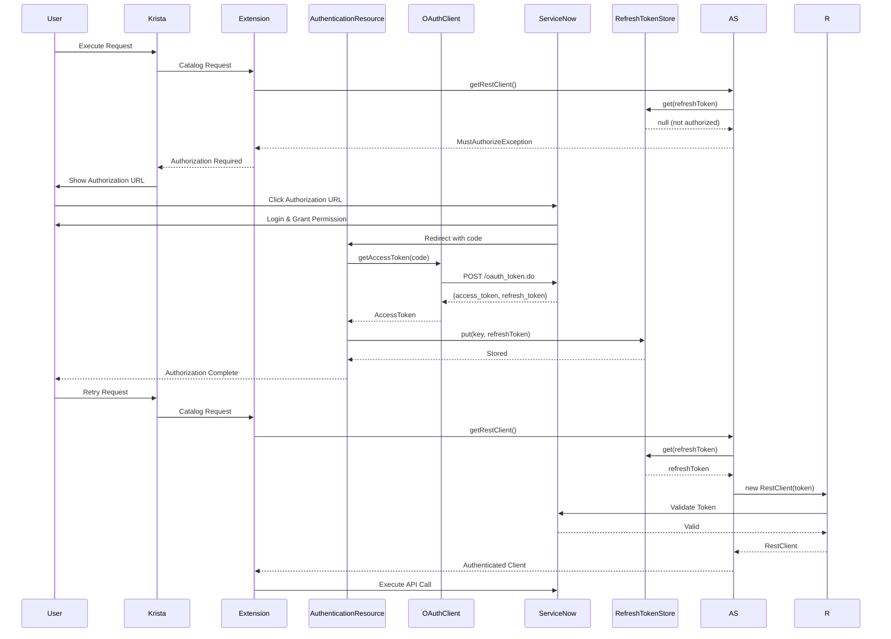

### Basic Authentication Flow

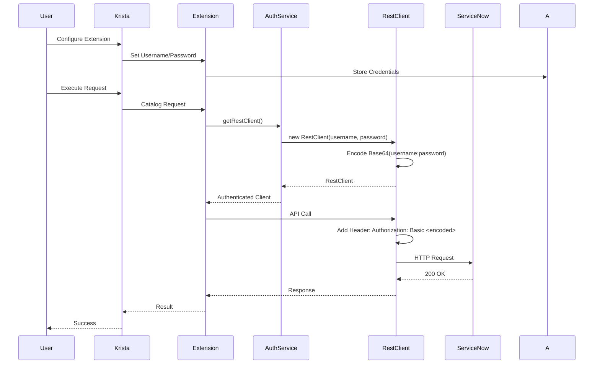

### Token Management

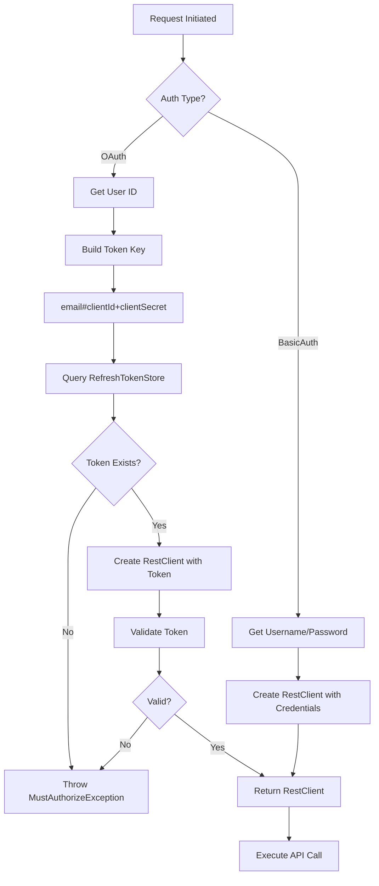

---

## Request Flow

### Catalog Request Execution

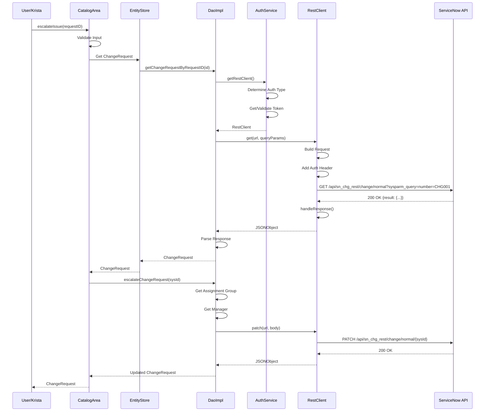

### Entity Create Operation

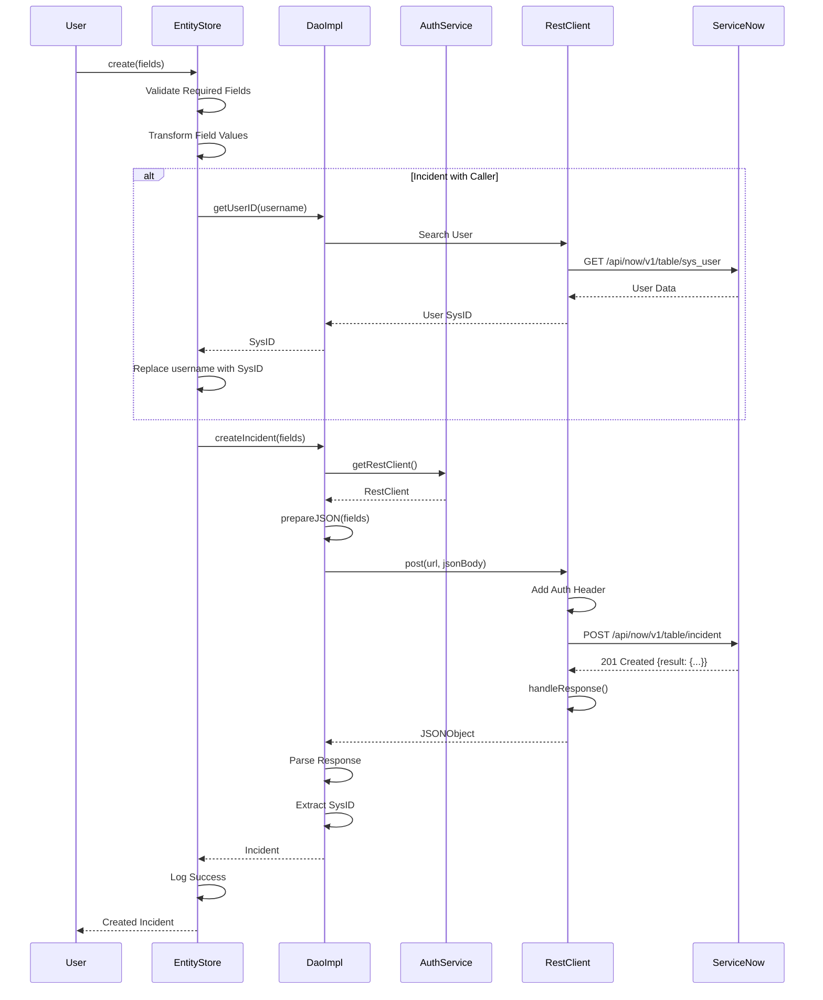

### Search Operation Flow

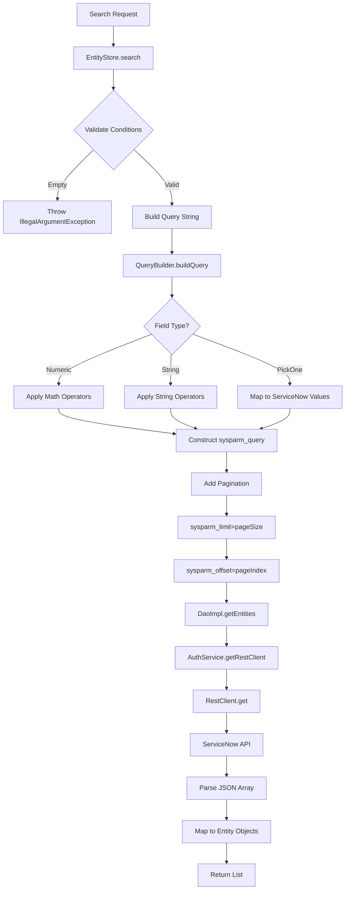

---

## Entity Operations

### Entity Store Pattern

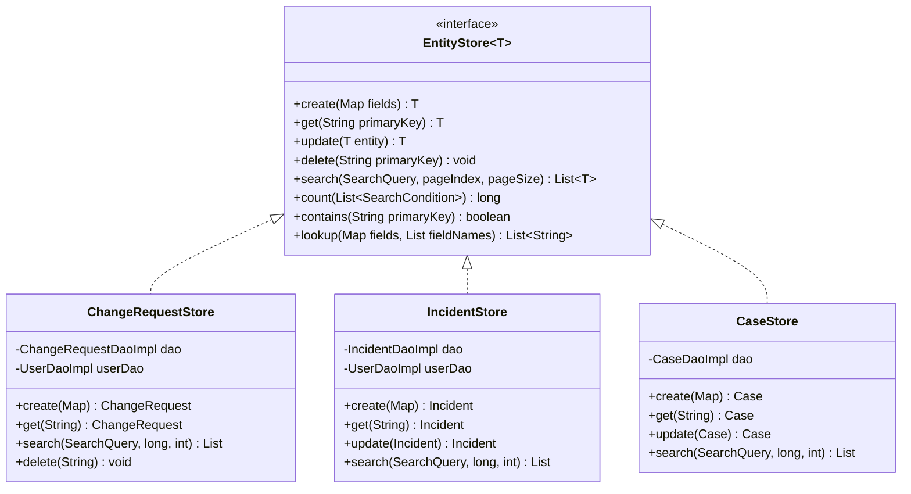

### DAO Implementation Pattern

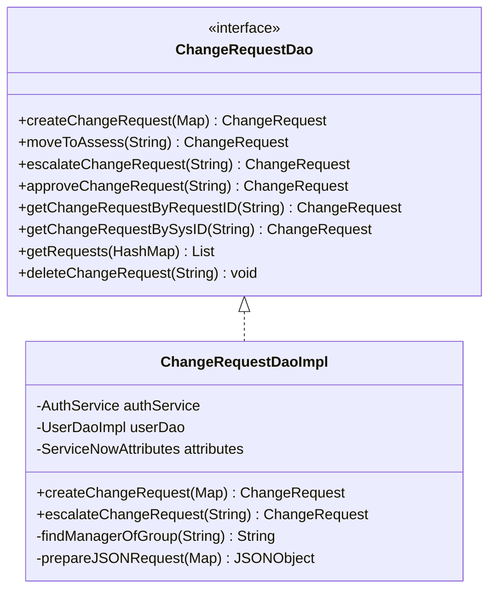

---

## Error Handling

### Error Propagation Flow

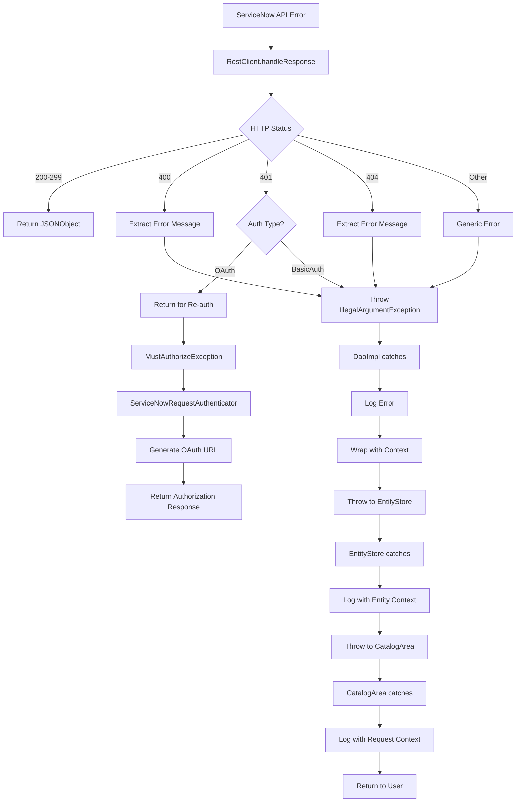

### Exception Hierarchy

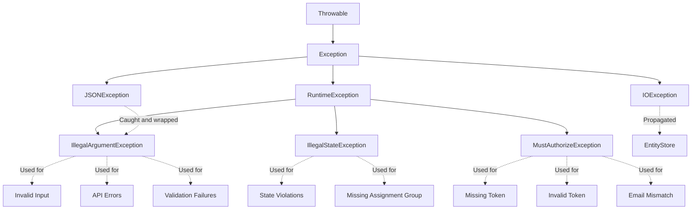

### Error Scenarios Matrix

| Error Scenario | Layer | Exception Type | HTTP Status | User-Friendly Message | Recovery Action |
|---|---|---|---|---|---|
| Invalid URL | Extension | IllegalArgumentException | N/A | "Invalid ServiceNow Instance URL. Please provide a valid URL (e.g., https://your-instance.service-now.com)." | Fix configuration with correct URL format |
| Missing Refresh Token | AuthService | MustAuthorizeException | N/A | "Authorization required. Please authorize the extension to access ServiceNow." | Click authorization link and grant permissions |
| Invalid Token | AuthService | MustAuthorizeException | 401 | "Your authorization has expired. Please re-authorize the extension." | Re-authorize through OAuth flow |
| Email Mismatch | AuthResource | IllegalArgumentException | N/A | "Email mismatch. The authorized email doesn't match the configured email." | Update configuration with correct email |
| Missing Assignment Group | ChangeRequestStore | IllegalStateException | N/A | "Assignment Group is required when creating change request with state 'Assess'." | Specify Assignment Group in request |
| Manager Not Found | ChangeRequestDaoImpl | IllegalArgumentException | N/A | "Manager not found for Assignment Group. Please assign a Manager to the group in ServiceNow." | Assign Manager to group in ServiceNow |
| Entity Not Found | DaoImpl | IllegalArgumentException | 404 | "Unable to retrieve [entity]. Please verify the ID is correct and exists in ServiceNow." | Verify ID and check entity exists |
| Invalid Input | DaoImpl | IllegalArgumentException | 400 | "Invalid request data. Please verify all input fields are correct and properly formatted." | Review and fix input field values |
| User Not Found | UserDaoImpl | IllegalArgumentException | 404 | "Unable to find user. Please verify the username is correct and exists in ServiceNow." | Verify username and check user exists |
| Empty Search Conditions | IncidentDaoImpl | IllegalArgumentException | N/A | "Search criteria cannot be empty. Please provide at least one search condition." | Add search conditions to query |
| JSON Parse Error | DaoImpl | IllegalArgumentException | N/A | "Unable to process ServiceNow API response. Please verify your ServiceNow instance is accessible." | Check ServiceNow accessibility and retry |
| Network Timeout | RestClient | (Jersey Exception) | N/A | "Connection timeout. Please check your network connection and ServiceNow instance availability." | Verify network and retry request |
| Create Incident Failed | IncidentDaoImpl | IllegalArgumentException | N/A | "Failed to create incident. Verify all required fields are provided and caller username exists." | Check required fields and caller username |
| Update Incident Failed | IncidentDaoImpl | IllegalArgumentException | N/A | "Failed to update incident. Verify the incident exists and you have permission to modify it." | Check incident exists and permissions |
| Assign User Failed | IncidentDaoImpl | IllegalArgumentException | N/A | "Failed to assign user to incident. Verify both user and incident System IDs are correct." | Verify both System IDs exist |
| Create Change Request Failed | ChangeRequestDaoImpl | IllegalArgumentException | N/A | "Failed to create change request. Ensure Assignment Group is specified and all fields are valid." | Provide Assignment Group and validate fields |
| Escalate Change Request Failed | ChangeRequestDaoImpl | IllegalArgumentException | N/A | "Failed to escalate change request. Verify Assignment Group has a designated Manager." | Assign Manager to Assignment Group |
| Create Case Failed | CaseDaoImpl | IllegalArgumentException | N/A | "Failed to create case. Verify all required fields and ensure Customer/User System IDs exist." | Validate fields and System IDs |
| Customer Not Found | CustomerDaoImpl | IllegalArgumentException | 404 | "Unable to retrieve customer account. Verify the System ID is correct." | Check Customer System ID |

---

## Performance Considerations

### Pagination Strategy

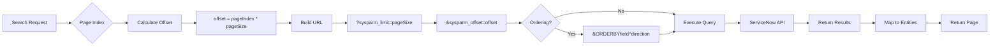

### Performance Characteristics

| Operation | Default Limit | Max Recommended | Notes |
|---|---|---|---|
| Search Results | 1000 | 1000 | ServiceNow default limit |
| Page Size | Variable | 500 | Optimal for performance |
| Concurrent Requests | N/A | Depends on ServiceNow tier | Rate limited by ServiceNow |
| Token Validation | Per Request | Cached | Validated before each API call |
| Connection Timeout | Jersey Default | Configurable | No explicit timeout set |
| Read Timeout | Jersey Default | Configurable | No explicit timeout set |

### Query Optimization

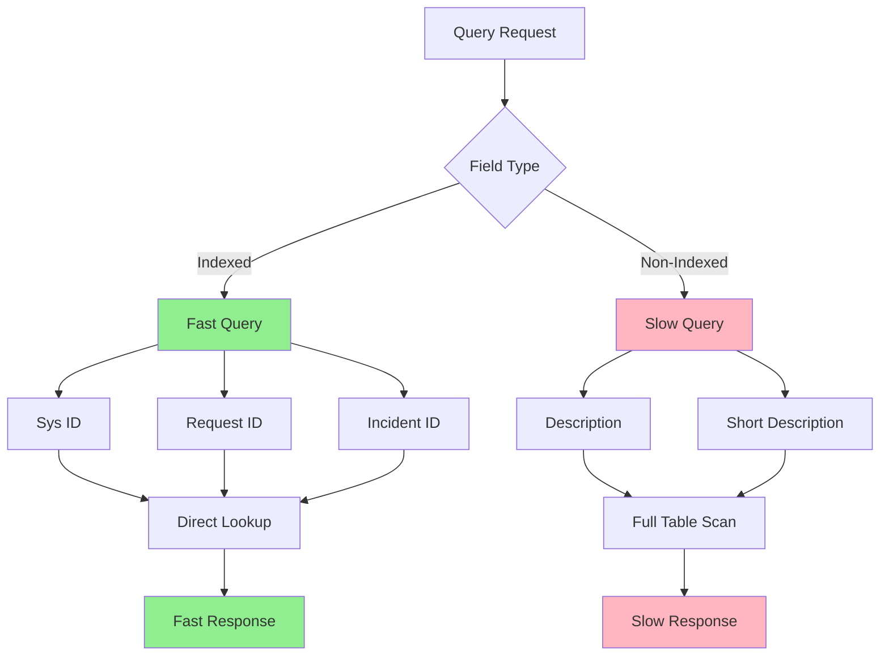

### Limitations

1. **Rate Limiting**
   - Enforced by ServiceNow instance
   - Varies by subscription tier
   - No client-side throttling
   - Typical: 1000 requests/hour/user

2. **Pagination**
   - Maximum 1000 records per request
   - Page index is zero-based
   - Offset calculated as: `pageIndex * pageSize`

3. **Search Performance**
   - Non-indexed fields cause full table scans
   - Complex queries may timeout
   - Use indexed fields when possible

4. **Token Management**
   - Token validated on every request
   - Failed validation requires re-authorization
   - No automatic token refresh

5. **Supported Operations**
   - Only Normal Change Requests supported
   - No bulk operations
   - No file attachment support
   - No custom field mapping

6. **Network**
   - No explicit timeout configuration
   - Relies on Jersey client defaults
   - Long operations may timeout

---

## Deployment Architecture

### Runtime Components

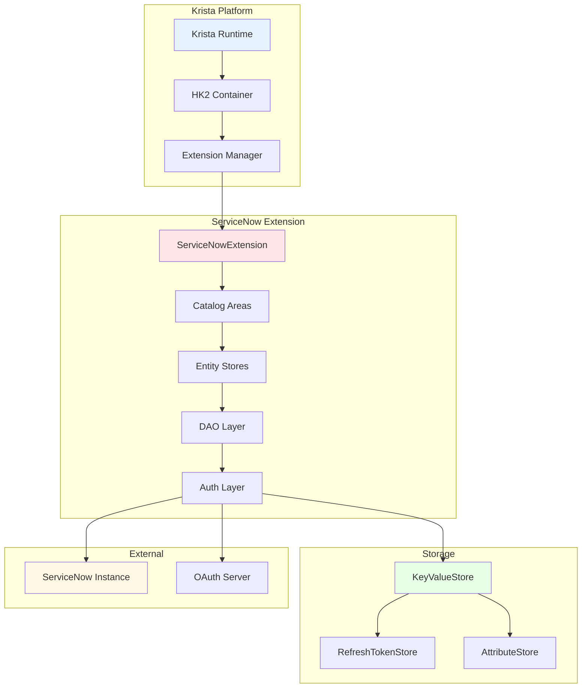

### Configuration Flow

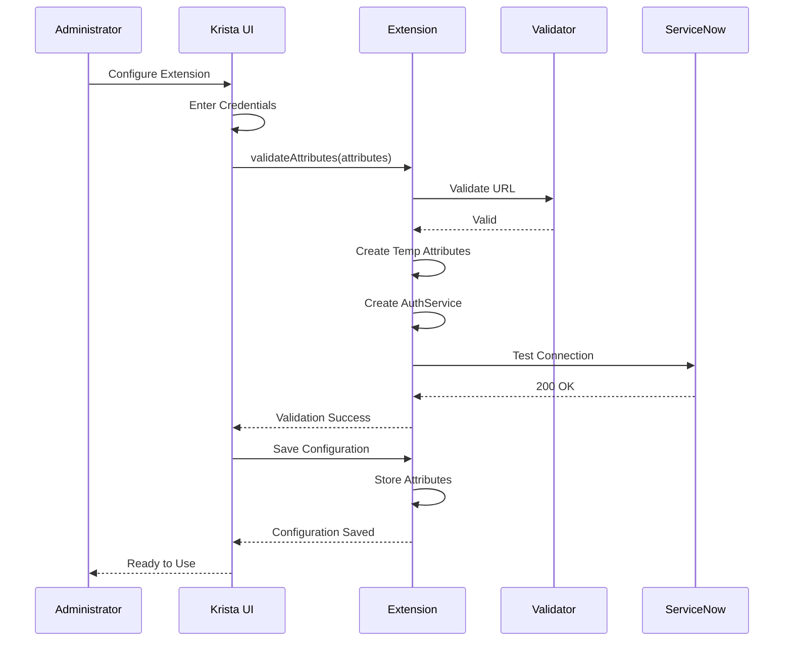

---

## Summary

The ServiceNow Extension implements a robust five-layer architecture that provides:

1. **Clear Separation of Concerns**: Each layer has distinct responsibilities
2. **Dependency Injection**: Managed by HK2 container for loose coupling
3. **Flexible Authentication**: Supports both OAuth 2.0 and Basic Auth
4. **Comprehensive Error Handling**: Multi-layer error propagation with context
5. **Performance Optimization**: Pagination, query building, and caching
6. **Extensibility**: Easy to add new entities and catalog requests

### Key Design Patterns

- **Layered Architecture**: Five distinct layers
- **Factory Pattern**: AuthServiceFactory for creating auth services
- **Store Pattern**: Entity stores for CRUD operations
- **DAO Pattern**: Data access objects for API interaction
- **Dependency Injection**: HK2 for component wiring
- **Strategy Pattern**: Different auth strategies (OAuth/BasicAuth)

### Technology Stack

- **Java 11**: Core language
- **Krista APIs 1.0.101**: Extension framework
- **Jersey Client 2.35**: HTTP client
- **HK2 2.6.1**: Dependency injection
- **ScribeJava 8.3.1**: OAuth implementation
- **Log4j 2.20.0**: Logging
- **Commons Validator 1.7**: URL validation

---

## Troubleshooting

### Common Error Patterns

#### Authentication Errors

**Pattern:** MustAuthorizeException thrown from AuthService

**Root Causes:**
1. Refresh token not found in RefreshTokenStore
2. Token expired or invalid
3. Email mismatch between configuration and authorization

**Resolution Flow:**
```
1. Check if token exists in RefreshTokenStore
2. If missing → Trigger OAuth authorization flow
3. If exists but invalid → Clear token and re-authorize
4. If email mismatch → Update configuration
```

#### Validation Errors

**Pattern:** IllegalArgumentException with validation message

**Root Causes:**
1. Required fields missing (e.g., Assignment Group)
2. Invalid field values (e.g., wrong State for new incident)
3. Referenced entities don't exist (e.g., invalid username)

**Resolution Flow:**
```
1. Parse error message for specific field
2. Validate field value against ServiceNow constraints
3. For references, verify entity exists using search
4. Correct input and retry
```

#### API Response Errors

**Pattern:** IllegalArgumentException from RestClient.handleResponse()

**Root Causes:**
1. HTTP 400: Invalid request data
2. HTTP 401: Authentication failure
3. HTTP 404: Entity not found
4. JSON parsing failure

**Resolution Flow:**
```
1. Check HTTP status code
2. Extract ServiceNow error message from response
3. For 401 with OAuth → Return for re-auth
4. For 401 with BasicAuth → Throw error
5. For 400/404 → Extract and throw ServiceNow message
6. For JSON errors → Throw parsing error
```

### Debugging Tips

1. **Enable Detailed Logging:**
   - Check Log4j configuration
   - Review logs at INFO and DEBUG levels
   - Look for error stack traces

2. **Verify ServiceNow Configuration:**
   - Test API endpoints directly using Postman
   - Verify user permissions in ServiceNow
   - Check plugin installations

3. **Validate Input Data:**
   - Use ServiceNow UI to verify entity IDs
   - Test field values in ServiceNow first
   - Ensure referenced entities exist

4. **Check Network Connectivity:**
   - Verify ServiceNow instance is accessible
   - Check for firewall or proxy issues
   - Test connection using Test Connection button

5. **Review Token Management:**
   - Check RefreshTokenStore for token presence
   - Verify token key format: `email#clientId+clientSecret`
   - Clear and re-authorize if token issues persist

### Error Message Improvements

All error messages in the extension follow these principles:

1. **User-Friendly:** Clear, non-technical language
2. **Actionable:** Specific steps to resolve the issue
3. **Contextual:** Include relevant IDs or field names
4. **Helpful:** Suggest next steps or alternatives

**Example Transformation:**

❌ **Old:** "Error occurred while fetching Incident for the given Sys Id."

✅ **New:** "Unable to retrieve incident. Please verify the System ID is correct and the incident exists in ServiceNow. If the problem persists, check your connection and permissions."

### Best Practices for Error Handling

1. **Catch Specific Exceptions:** Handle JSONException, IllegalArgumentException separately
2. **Add Context:** Wrap exceptions with operation context
3. **Log Before Throwing:** Log errors with full context before propagating
4. **Preserve Cause:** Always include original exception as cause
5. **Fail Fast:** Validate inputs early before making API calls

---

## Additional Resources

### Documentation

- **User Documentation:** `servicenow/src/main/resources/documentation/pages/`
  - Overview.md - Extension overview and quick start
  - serviceNow.md - ServiceNow setup instructions
  - configureExtension.md - Extension configuration guide
  - requests.md - Complete API reference
  - troubleshooting.md - Detailed troubleshooting guide
  - releaseNotes.md - Version history

- **Architecture Documentation:** `servicenow/docs/Architecture.md` (this document)

### ServiceNow Resources

- [ServiceNow REST API Documentation](https://docs.servicenow.com/bundle/tokyo-application-development/page/integrate/inbound-rest/concept/c_RESTAPI.html)
- [ServiceNow Change Management](https://docs.servicenow.com/bundle/tokyo-it-service-management/page/product/change-management/concept/c_ITILChangeManagement.html)
- [ServiceNow OAuth Setup](https://docs.servicenow.com/bundle/tokyo-platform-administration/page/administer/security/task/t_SettingUpOAuth.html)

### Support

For issues or questions:
1. Review the troubleshooting guide
2. Check ServiceNow system logs
3. Verify extension configuration
4. Contact support with complete error messages and context

---

**Document Version**: 1.0
**Last Updated**: December 2025
**Extension Version**: 2.0.6

