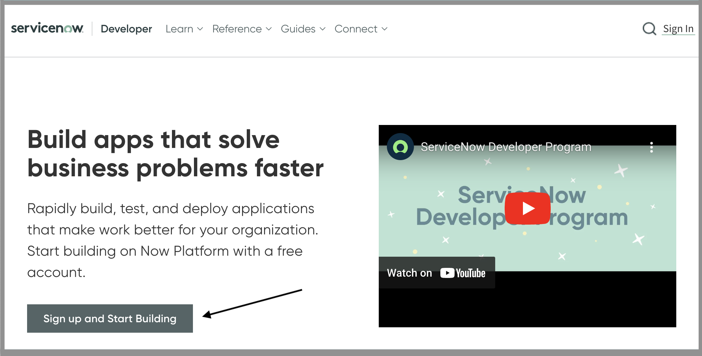
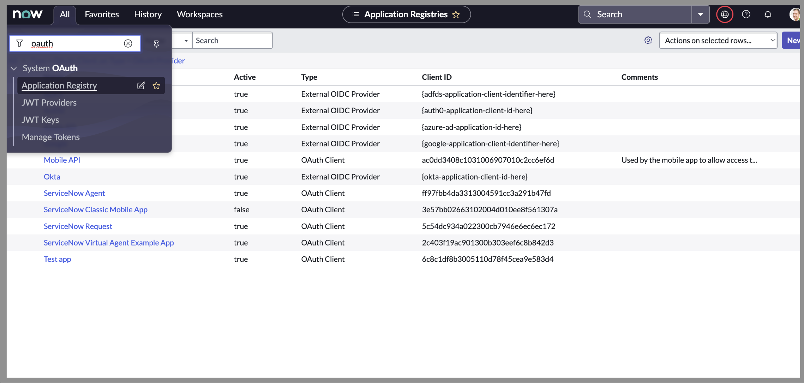
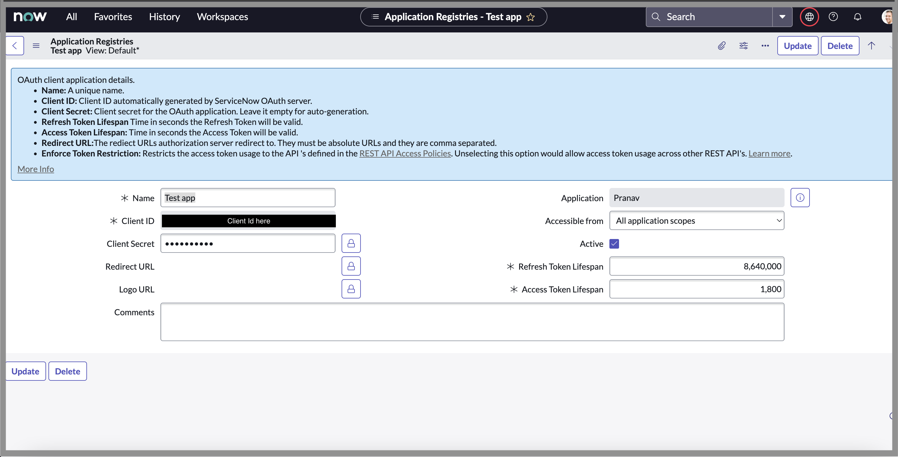
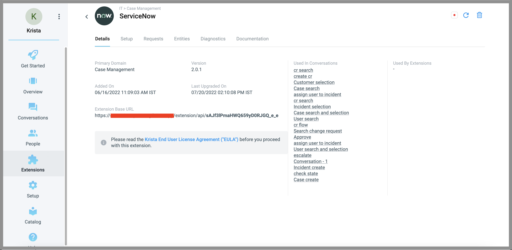

# Creating ServiceNow OAuth Application

## Overview

To use OAuth 2.0 authentication with the Krista ServiceNow Extension, you must first create an OAuth application in your ServiceNow instance. This application provides the Client ID and Client Secret required for secure authentication.

This guide provides step-by-step instructions for creating and configuring a ServiceNow OAuth application.

## Prerequisites

Before you begin, ensure you have:

- **ServiceNow Instance Access**: Developer or production ServiceNow instance
- **Admin Privileges**: Ability to create OAuth applications in ServiceNow
- **Krista Extension Added**: ServiceNow extension added to your Krista environment (to obtain redirect URI)

> **💡 Tip**: If you don't have a ServiceNow instance, you can create a free developer instance following Step 1 below.

## Step-by-Step Guide

### Step 1: Create ServiceNow Developer Instance (Optional)

If you don't already have a ServiceNow instance, you can create a free developer instance:

1. Navigate to [ServiceNow Developer Site](https://developer.servicenow.com)

2. Click **Sign up and Start Building**

3. Complete the registration form:
   - **Email**: Your email address
   - **First Name**: Your first name
   - **Last Name**: Your last name
   - **Company**: Your company or "Personal"
   - **Country**: Your country

4. Click **Sign Up**

5. Check your email for account activation link

6. After activation, request a developer instance:
   - Log in to the developer portal
   - Click **Request Instance**
   - Select the ServiceNow release version
   - Wait for instance provisioning (typically 2-5 minutes)

7. Save your instance credentials:
   - **Instance URL**: `https://devXXXXX.service-now.com` (where XXXXX is your instance number)
   - **Username**: `admin`
   - **Password**: Provided in the instance details

> **📝 Note**: Developer instances are automatically hibernated after inactivity and wake up when accessed. They are reset periodically, so don't use them for production data.

### Step 2: Navigate to Application Registry

1. Log in to your ServiceNow instance as an administrator

2. In the navigation filter (top-left search), type: **Application Registry**

3. Navigate to: **All → System OAuth → Application Registry**

4. Click **New** to create a new OAuth application

5. Select **Create an OAuth API endpoint for external clients**

> **📝 Note**: Do not select "Connect to a third party OAuth Provider" - this is for ServiceNow to connect to external OAuth providers, not for external clients to connect to ServiceNow.

### Step 3: Configure OAuth Application

Fill in the OAuth application configuration form:

#### Required Fields

| Field | Description | Example | Notes |
|-------|-------------|---------|-------|
| **Name** | Application name (for identification) | `Krista Integration` | Choose a descriptive name |
| **Client ID** | Unique identifier for the application | `a1b2c3d4e5f6g7h8i9j0` | Auto-generated; copy this value |
| **Client Secret** | Secret key for authentication | `••••••••••••••••` | Leave blank for auto-generation or enter custom value |
| **Redirect URL** | Callback URL for OAuth flow | `https://krista.example.com/extension/api/abc123/servicenow/callback` | Must match Krista callback URI exactly |
| **Accessible From** | Application accessibility scope | `All application scopes` | Default value is fine |
| **Refresh Token Lifespan** | Refresh token expiration (seconds) | `31536000` (1 year) | Default: 8640000 (100 days) |
| **Access Token Lifespan** | Access token expiration (seconds) | `3600` (1 hour) | Default: 1800 (30 minutes) |
| **Active** | Enable/disable the application | ☑ Checked | Must be checked |

#### Field Details

##### 1. Name
- **Purpose**: Identifies the OAuth application in ServiceNow
- **Recommendation**: Use a descriptive name like "Krista Integration" or "Krista ServiceNow Extension"
- **Example**: `Krista Integration - Production`

##### 2. Client ID
- **Purpose**: Unique identifier for your OAuth application
- **Auto-generated**: ServiceNow automatically generates this when you create the application
- **Action Required**: Copy this value - you'll need it for Krista configuration
- **Format**: Alphanumeric string (typically 32 characters)
- **Example**: `a1b2c3d4e5f6g7h8i9j0k1l2m3n4o5p6`

##### 3. Client Secret
- **Purpose**: Secret key used to authenticate the application
- **Options**:
  - **Leave blank**: ServiceNow auto-generates a secure secret
  - **Enter custom value**: Provide your own secret (must be secure)
- **Recommendation**: Leave blank for auto-generation
- **Action Required**: Copy this value after creation - you'll need it for Krista configuration
- **Security**: Never share this secret or commit it to version control

##### 4. Redirect URL
- **Purpose**: URL where ServiceNow redirects after user authorization
- **Critical**: Must match exactly with Krista's callback URI
- **Format**: `{krista_base_url}/extension/api/{extension_id}/servicenow/callback`

**How to Find Your Redirect URL:**

1. In Krista, navigate to the ServiceNow extension
2. Go to the extension's **Details** section
3. Find the **Extension Base URL**

4. Append `/servicenow/callback` to the base URL

**Example:**
- Extension Base URL: `https://krista.example.com/extension/api/abc123`
- Redirect URL: `https://krista.example.com/extension/api/abc123/servicenow/callback`

> **⚠️ Important**: 
> - The redirect URL must match **exactly** (including protocol, domain, path, and case)
> - ServiceNow allows only **one** redirect URL per application
> - To use multiple Krista environments, create separate OAuth applications for each

##### 5. Accessible From
- **Purpose**: Defines which ServiceNow application scopes can use this OAuth application
- **Default**: `All application scopes`
- **Recommendation**: Keep default value unless you have specific security requirements

##### 6. Refresh Token Lifespan
- **Purpose**: How long refresh tokens remain valid (in seconds)
- **Default**: 8640000 seconds (100 days)
- **Recommendation**: 31536000 seconds (1 year) for production
- **Range**: 1 second to 315360000 seconds (10 years)
- **Note**: Users must re-authorize when refresh token expires

**Common Values:**
- 1 day: `86400`
- 30 days: `2592000`
- 100 days: `8640000` (default)
- 1 year: `31536000`
- Never expire: `315360000` (10 years)

##### 7. Access Token Lifespan
- **Purpose**: How long access tokens remain valid (in seconds)
- **Default**: 1800 seconds (30 minutes)
- **Recommendation**: 3600 seconds (1 hour)
- **Range**: 1 second to 31536000 seconds (1 year)
- **Note**: Access tokens are automatically refreshed using refresh token

**Common Values:**
- 30 minutes: `1800` (default)
- 1 hour: `3600`
- 2 hours: `7200`
- 1 day: `86400`

##### 8. Active
- **Purpose**: Enable or disable the OAuth application
- **Required**: Must be checked for the application to work
- **Action**: Check this box

### Step 4: Save and Copy Credentials

1. Click **Submit** to create the OAuth application

2. The application is created and you're returned to the Application Registry list

3. **Important**: Open the application you just created to view the Client Secret

4. Copy the following values (you'll need them for Krista configuration):
   - **Client ID**
   - **Client Secret**

> **⚠️ Security Warning**: The Client Secret is displayed only once after creation. If you lose it, you'll need to generate a new one. Store it securely (e.g., password manager).

### Step 5: Verify Configuration

Before proceeding to Krista configuration, verify your OAuth application:

1. **Check Active Status**: Ensure the "Active" checkbox is checked

2. **Verify Redirect URL**: Confirm it matches your Krista callback URI exactly

3. **Test Accessibility**: Ensure "Accessible From" is set appropriately

4. **Confirm Credentials**: Verify you have copied both Client ID and Client Secret

## Multiple Environments

If you need to connect multiple Krista environments (e.g., development, staging, production) to the same ServiceNow instance, you must create separate OAuth applications for each environment because ServiceNow allows only one redirect URL per application.

### Example Setup

| Environment | OAuth Application Name | Redirect URL |
|-------------|----------------------|--------------|
| Development | `Krista Integration - Dev` | `https://dev.krista.example.com/extension/api/abc123/servicenow/callback` |
| Staging | `Krista Integration - Staging` | `https://staging.krista.example.com/extension/api/def456/servicenow/callback` |
| Production | `Krista Integration - Prod` | `https://krista.example.com/extension/api/ghi789/servicenow/callback` |

### Best Practices

1. **Naming Convention**: Use clear names indicating the environment
2. **Separate Credentials**: Each environment has its own Client ID and Client Secret
3. **Document Mapping**: Maintain a document mapping environments to OAuth applications
4. **Security**: Use longer token lifespans for production, shorter for development

## Updating OAuth Application

### Changing Redirect URL

If your Krista environment URL changes:

1. Navigate to **All → System OAuth → Application Registry**
2. Open your OAuth application
3. Update the **Redirect URL** field
4. Click **Update**
5. No need to update Client ID or Client Secret in Krista

### Regenerating Client Secret

If you need to regenerate the Client Secret:

1. Navigate to **All → System OAuth → Application Registry**
2. Open your OAuth application
3. Clear the **Client Secret** field
4. Click **Update**
5. ServiceNow generates a new Client Secret
6. Copy the new Client Secret
7. Update the Client Secret in Krista extension configuration
8. All users must re-authorize

### Deactivating Application

To temporarily disable the OAuth application:

1. Navigate to **All → System OAuth → Application Registry**
2. Open your OAuth application
3. Uncheck the **Active** checkbox
4. Click **Update**
5. All existing tokens are immediately invalidated
6. Users cannot authorize until reactivated

## Troubleshooting

### Cannot Find Application Registry

**Problem**: "Application Registry" doesn't appear in navigation

**Solutions**:
1. Verify you're logged in as administrator
2. Check you have `admin` or `oauth_admin` role
3. Try direct URL: `https://{instance}/nav_to.do?uri=oauth_entity.do`

### Redirect URL Mismatch Error

**Problem**: "redirect_uri_mismatch" error during authorization

**Solutions**:
1. Verify redirect URL in ServiceNow matches Krista callback URI exactly
2. Check for typos, extra spaces, or incorrect case
3. Ensure protocol (https://) is included
4. Verify no trailing slashes

### Client Secret Not Visible

**Problem**: Cannot see Client Secret after creation

**Solutions**:
1. Client Secret is shown only once after creation
2. If lost, regenerate by clearing the field and updating
3. Copy new secret and update in Krista

### Authorization Fails After Setup

**Problem**: Authorization fails even with correct credentials

**Solutions**:
1. Verify "Active" checkbox is checked
2. Check token lifespans are not set to 0
3. Ensure "Accessible From" is set to "All application scopes"
4. Verify ServiceNow instance is accessible from Krista
5. Check ServiceNow system logs for OAuth errors

## Next Steps

After creating your ServiceNow OAuth application:

1. **Configure Extension in Krista**
   - Go to [Extension Configuration](pages/ExtensionConfiguration.md)
   - Enter Client ID and Client Secret
   - Complete OAuth authorization flow

2. **Understand Authentication**
   - Read [Authentication Guide](pages/Authentication.md)
   - Learn about token management and refresh flows

3. **Start Using Extension**
   - Explore [Catalog Requests](/)
   - Review [Entity Documentation](/)

## See Also

- [Extension Configuration](pages/ExtensionConfiguration.md) - Configure the extension in Krista
- [Authentication](pages/Authentication.md) - Understand OAuth 2.0 flow and token management
- [Troubleshooting](pages/troubleshooting.md) - Common issues and solutions
- [ServiceNow OAuth Documentation](https://docs.servicenow.com/bundle/tokyo-platform-administration/page/administer/security/task/t_SettingUpOAuth.html) - Official ServiceNow OAuth setup guide

