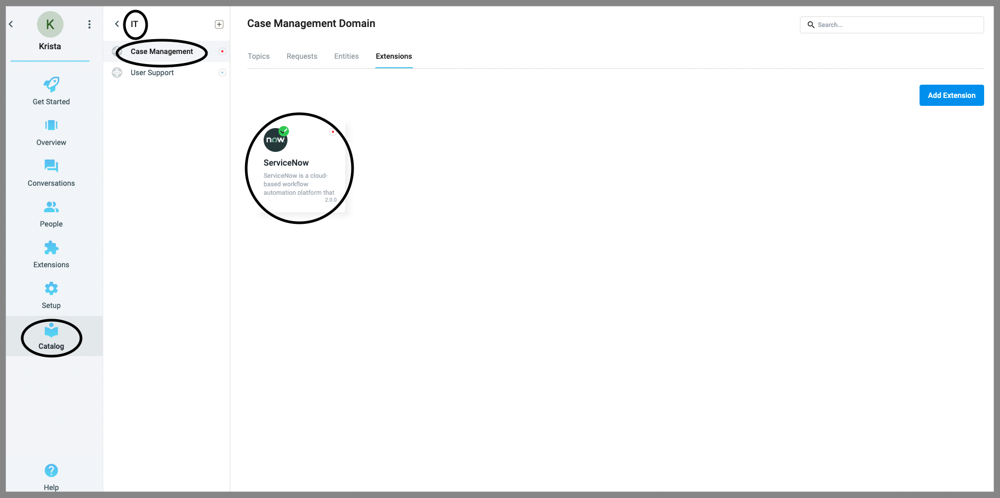
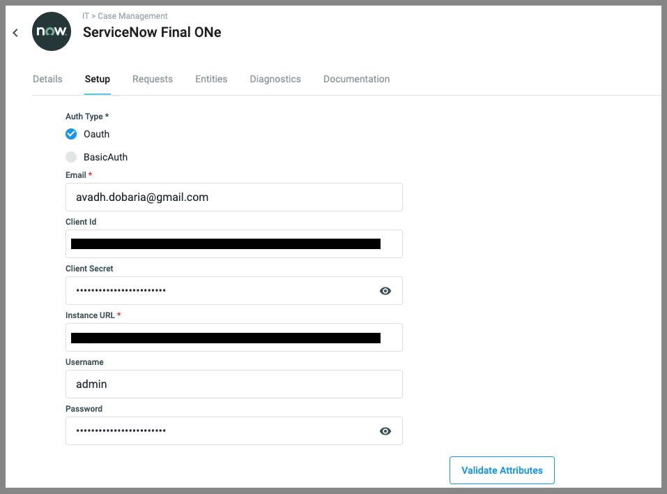
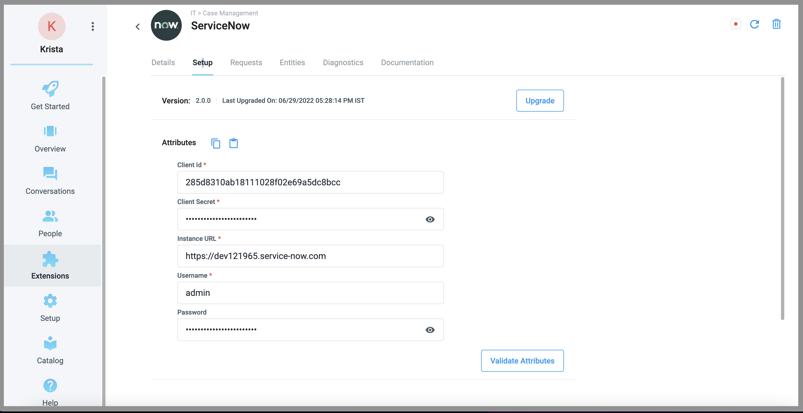
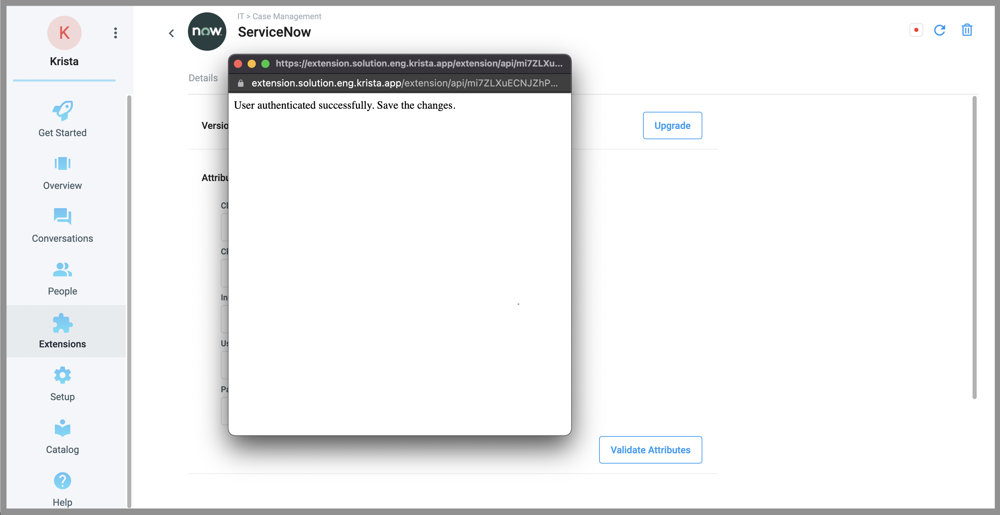
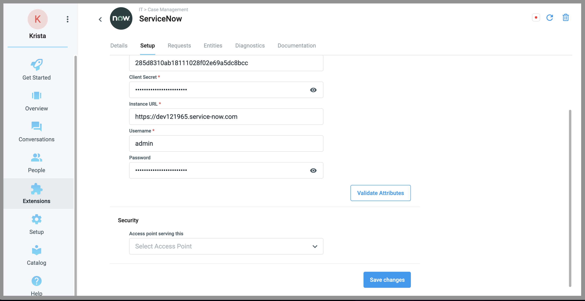

# Extension Configuration

## Overview

This guide explains how to configure the Krista ServiceNow Extension to connect to your ServiceNow instance. The extension supports two authentication methods: **OAuth 2.0** (recommended for user-based access) and **Basic Authentication** (for service account integration).

## Configuration Parameters

The following table lists all configuration parameters required to set up the ServiceNow extension:

| Parameter | Type | Required | Description | Example |
|-----------|------|----------|-------------|---------|
| **Auth Type** | Pick One | Yes | Authentication method to use | `Oauth` or `BasicAuth` |
| **Instance URL** | Text | Yes | Your ServiceNow instance URL | `https://dev12345.service-now.com` |
| **Email** | Text | Yes | Email address for OAuth authorization | `user@company.com` |
| **Client ID** | Text | Conditional* | OAuth 2.0 Client ID from ServiceNow | `a1b2c3d4e5f6g7h8i9j0` |
| **Client Secret** | Text (Secured) | Conditional* | OAuth 2.0 Client Secret from ServiceNow | `••••••••••••••••` |
| **Username** | Text | Conditional** | ServiceNow username for Basic Auth | `admin` or `service.account` |
| **Password** | Text (Secured) | Conditional** | ServiceNow password for Basic Auth | `••••••••••••••••` |

**Notes:**
- *Required when Auth Type = `Oauth`
- **Required when Auth Type = `BasicAuth`

### Parameter Details

#### Auth Type
- **Purpose**: Determines which authentication method to use
- **Options**:
  - `Oauth` - OAuth 2.0 authorization (recommended for user-based access)
  - `BasicAuth` - Basic Authentication (for service accounts)
- **Default**: None (must be selected)
- **When to use OAuth**: When you need user-specific permissions and want secure, token-based authentication
- **When to use Basic Auth**: When using a dedicated service account with fixed credentials

#### Instance URL
- **Purpose**: The base URL of your ServiceNow instance
- **Format**: `https://your-instance.service-now.com`
- **Validation**: Must be a valid HTTPS URL
- **Examples**:
  - Developer instance: `https://dev12345.service-now.com`
  - Production instance: `https://company.service-now.com`
- **Important**: Do not include trailing slashes or API paths

#### Email
- **Purpose**: Email address used for OAuth authorization and user identification
- **Format**: Valid email address
- **Usage**: 
  - For OAuth: Must match the email of the ServiceNow user authorizing the extension
  - For Basic Auth: Used for identification and logging
- **Example**: `john.doe@company.com`

#### Client ID
- **Purpose**: OAuth 2.0 application identifier from ServiceNow
- **Required for**: OAuth authentication only
- **How to obtain**: See [Creating ServiceNow OAuth Application](pages/CreatingServiceNowApp.md)
- **Format**: Alphanumeric string
- **Example**: `a1b2c3d4e5f6g7h8i9j0k1l2m3n4o5p6`

#### Client Secret
- **Purpose**: OAuth 2.0 application secret from ServiceNow
- **Required for**: OAuth authentication only
- **Security**: Stored securely and never displayed after entry
- **How to obtain**: See [Creating ServiceNow OAuth Application](pages/CreatingServiceNowApp.md)
- **Format**: Alphanumeric string
- **Important**: Keep this secret secure and never share it

#### Username
- **Purpose**: ServiceNow account username for Basic Authentication
- **Required for**: Basic Authentication only
- **Format**: ServiceNow username (not email)
- **Examples**: `admin`, `integration.user`, `service.account`
- **Permissions**: User must have appropriate ServiceNow roles (see Prerequisites)

#### Password
- **Purpose**: ServiceNow account password for Basic Authentication
- **Required for**: Basic Authentication only
- **Security**: Stored securely and never displayed after entry
- **Format**: ServiceNow password
- **Important**: Use a strong password and consider using a dedicated service account

## Step-by-Step Setup

### Prerequisites

Before configuring the extension, ensure you have:

1. **ServiceNow Instance Access**
   - Developer or production ServiceNow instance
   - Admin access to create OAuth applications (for OAuth) or service accounts (for Basic Auth)

2. **Required ServiceNow Roles**
   - `itil` - For ITSM operations
   - `sn_change_read` and `sn_change_write` - For change management
   - `sn_customerservice_agent` - For case management (optional)

3. **ServiceNow Plugins**
   - **Customer Service Portal** plugin installed (required for Case and Customer entities)

4. **Krista Platform Access**
   - Access to add and configure extensions in Krista

### Option 1: OAuth 2.0 Configuration (Recommended)

#### Step 1: Create OAuth Application in ServiceNow

Follow the detailed guide: [Creating ServiceNow OAuth Application](pages/CreatingServiceNowApp.md)

You will obtain:
- Client ID
- Client Secret
- Redirect URI configuration

#### Step 2: Add Extension in Krista

1. Log in to your Krista platform
2. Navigate to **Extensions** section
3. Click **Add Extension**
4. Search for "ServiceNow" and select it
5. Click **Add** to add the extension to your environment



#### Step 3: Configure Extension Parameters

1. In the extension configuration screen, fill in the following:
   - **Auth Type**: Select `Oauth`
   - **Instance URL**: Enter your ServiceNow instance URL (e.g., `https://dev12345.service-now.com`)
   - **Email**: Enter the email address of the ServiceNow user who will authorize the extension
   - **Client ID**: Paste the Client ID from ServiceNow OAuth application
   - **Client Secret**: Paste the Client Secret from ServiceNow OAuth application



2. Click **Validate** to test the configuration



#### Step 4: Authorize the Extension

1. After validation, you'll see an authorization link
2. Click the authorization link
3. You'll be redirected to ServiceNow login page
4. Log in with the ServiceNow account matching the configured email
5. Grant permissions to the application
6. You'll be redirected back to Krista with "Authorization Complete" message



#### Step 5: Save Configuration

1. Click **Save** to save the extension configuration
2. The extension is now ready to use



### Option 2: Basic Authentication Configuration

#### Step 1: Create Service Account in ServiceNow (Recommended)

1. Log in to ServiceNow as administrator
2. Navigate to **All → User Administration → Users**
3. Click **New** to create a new user
4. Fill in user details:
   - **User ID**: Choose a descriptive name (e.g., `krista.integration`)
   - **First name**: Krista
   - **Last name**: Integration
   - **Email**: Service account email
5. Set a strong password
6. Assign required roles:
   - `itil`
   - `sn_change_read`
   - `sn_change_write`
   - `sn_customerservice_agent` (if using Case/Customer entities)
7. Click **Submit**

#### Step 2: Add and Configure Extension in Krista

1. Log in to your Krista platform
2. Navigate to **Extensions** section
3. Click **Add Extension** and select ServiceNow
4. In the configuration screen, fill in:
   - **Auth Type**: Select `BasicAuth`
   - **Instance URL**: Enter your ServiceNow instance URL
   - **Email**: Enter an email for identification
   - **Username**: Enter the ServiceNow username (e.g., `krista.integration`)
   - **Password**: Enter the ServiceNow password
5. Click **Validate** to test the connection
6. Click **Save** to save the configuration

## Redirect URI Configuration

### For OAuth Authentication

The redirect URI (callback URL) is automatically generated by Krista and must be configured in your ServiceNow OAuth application.

**Redirect URI Format:**
```
https://<krista-instance-url>/extension/api/<extension-id>/servicenow/callback
```

**How to find your Redirect URI:**
1. In Krista, go to the ServiceNow extension configuration
2. The redirect URI is displayed in the configuration screen
3. Copy this URI

**How to configure in ServiceNow:**
1. Log in to ServiceNow
2. Navigate to **All → System OAuth → Application Registry**
3. Open your OAuth application
4. In the **Redirect URL** field, paste the URI from Krista
5. Click **Update**

> **📝 Note**: The redirect URI must match exactly, including the protocol (https://) and any path components.

## Security Considerations

### Best Practices

1. **Use OAuth 2.0 When Possible**
   - OAuth provides better security with token-based authentication
   - Tokens can be revoked without changing passwords
   - Supports user-specific permissions

2. **Secure Credentials**
   - Never share Client Secrets or passwords
   - Use strong, unique passwords for service accounts
   - Rotate credentials regularly

3. **Principle of Least Privilege**
   - Grant only the minimum required ServiceNow roles
   - Use dedicated service accounts for Basic Auth
   - Avoid using personal admin accounts

4. **Monitor Access**
   - Review ServiceNow audit logs regularly
   - Monitor for unusual API activity
   - Set up alerts for failed authentication attempts

5. **Network Security**
   - Ensure HTTPS is used for all connections
   - Verify SSL certificates are valid
   - Use firewall rules to restrict access if needed

### OAuth Token Security

- **Access Tokens**: Short-lived (typically 1 hour), automatically refreshed
- **Refresh Tokens**: Long-lived, stored securely by Krista
- **Token Storage**: Encrypted at rest in Krista's secure storage
- **Token Revocation**: Tokens are automatically revoked when:
  - User changes password in ServiceNow
  - User revokes application access
  - Extension is reconfigured

### Basic Auth Security

- **Password Storage**: Encrypted at rest in Krista
- **Transmission**: Always sent over HTTPS
- **Service Accounts**: Use dedicated accounts, not personal accounts
- **Password Policy**: Follow your organization's password requirements

## Troubleshooting

### Invalid Instance URL Error

**Error Message:**
```
Invalid ServiceNow Instance URL: '<your-url>'. Please provide a valid URL (e.g., https://your-instance.service-now.com).
```

**Causes:**
- URL is not in correct format
- Missing `https://` protocol
- Trailing slashes or paths included
- Typos in the URL

**Solutions:**
1. Verify URL format: `https://your-instance.service-now.com`
2. Remove any trailing slashes: ❌ `https://dev12345.service-now.com/` → ✅ `https://dev12345.service-now.com`
3. Ensure HTTPS protocol is used
4. Check for typos in the instance name

### Authorization Failed (OAuth)

**Error Message:**
```
Authorization failed. Please verify your OAuth credentials (Client ID, Client Secret) and ensure the redirect URL is correctly configured in ServiceNow.
```

**Causes:**
- Incorrect Client ID or Client Secret
- Redirect URI mismatch in ServiceNow
- OAuth application not active in ServiceNow
- Email mismatch between configuration and ServiceNow user

**Solutions:**
1. Verify Client ID and Client Secret in ServiceNow:
   - Navigate to **All → System OAuth → Application Registry**
   - Open your application and verify credentials
2. Check Redirect URI:
   - Ensure it matches exactly in both Krista and ServiceNow
   - Include protocol and full path
3. Verify application is marked "Active" in ServiceNow
4. Ensure email in configuration matches ServiceNow user email

### Connection Failed (Basic Auth)

**Error Message:**
```
Connection test failed. Please verify your username and password are correct.
```

**Causes:**
- Incorrect username or password
- User account is inactive in ServiceNow
- User lacks required permissions
- Network connectivity issues

**Solutions:**
1. Verify username and password are correct
2. Check user account is active in ServiceNow:
   - Navigate to **All → User Administration → Users**
   - Search for the user and verify "Active" checkbox is checked
3. Verify user has required roles:
   - `itil`, `sn_change_read`, `sn_change_write`
4. Test ServiceNow instance accessibility from your network

### Email Mismatch Error

**Error Message:**
```
Email mismatch. The authorized email doesn't match the configured email.
```

**Cause:**
- The email configured in the extension doesn't match the email of the ServiceNow user who authorized the application

**Solution:**
1. Update the Email field in extension configuration to match the ServiceNow user's email
2. Re-authorize the extension

### Need More Help?

For additional troubleshooting guidance, see:
- **[Troubleshooting Guide](pages/troubleshooting.md)** - Comprehensive troubleshooting for all scenarios
- **[Authentication Guide](pages/Authentication.md)** - Detailed authentication flow and token management
- **[Creating ServiceNow App](pages/CreatingServiceNowApp.md)** - OAuth application setup guide

## Next Steps

After successfully configuring the extension:

1. **Understand Authentication** - Read the [Authentication Guide](pages/Authentication.md) to learn about OAuth flows and token management
2. **Explore Catalog Requests** - Review available operations:
   - [Escalate Issue](pages/EscalateIssue.md)
   - [Check Status](pages/CheckStatus.md)
   - [Approve Change Request](pages/ApproveChangeRequest.md)
   - [Assign User to Incident](pages/AssignUserToIncident.md)
3. **Work with Entities** - Learn about ServiceNow entities:
   - [Change Request Entity](pages/ChangeRequestEntity.md)
   - [Incident Entity](pages/IncidentEntity.md)
   - [Case Entity](pages/CaseEntity.md)

## See Also

- [Authentication](pages/Authentication.md) - OAuth 2.0 and Basic Authentication details
- [Creating ServiceNow OAuth Application](pages/CreatingServiceNowApp.md) - Step-by-step OAuth setup
- [Troubleshooting](pages/troubleshooting.md) - Common issues and solutions

